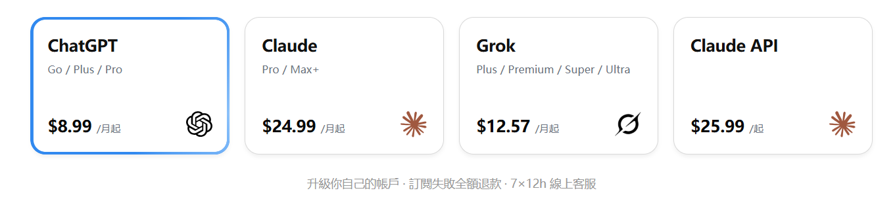
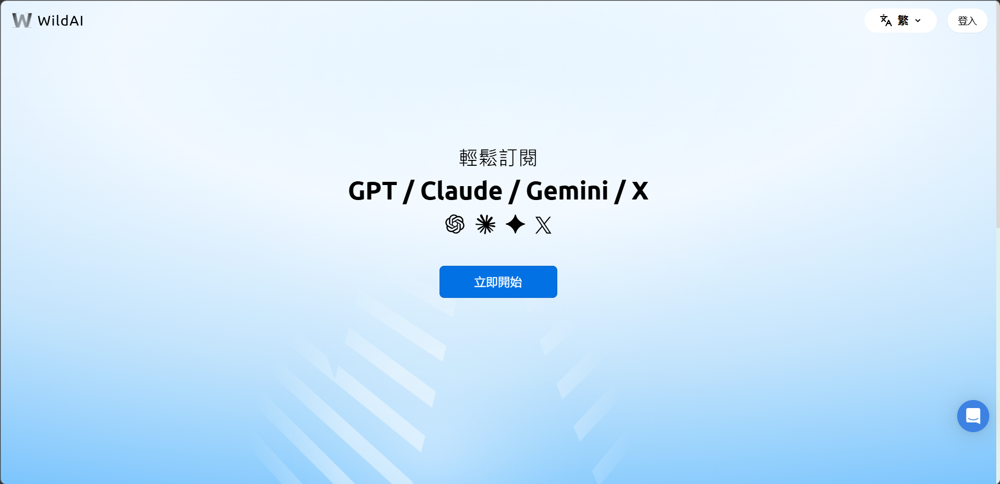
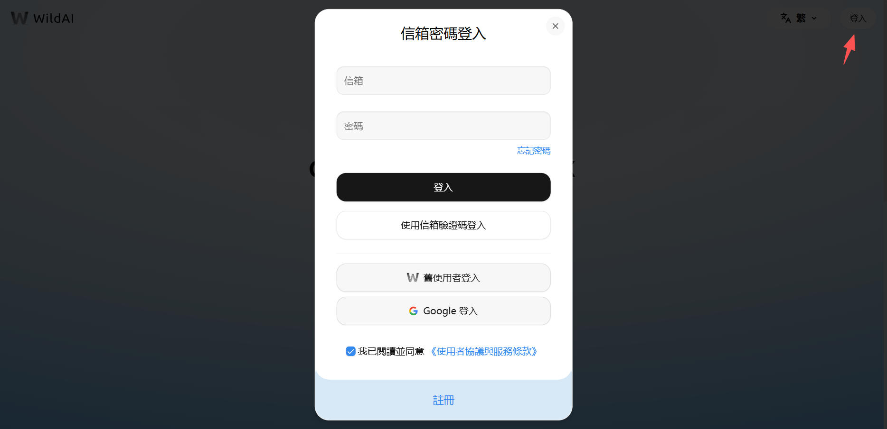
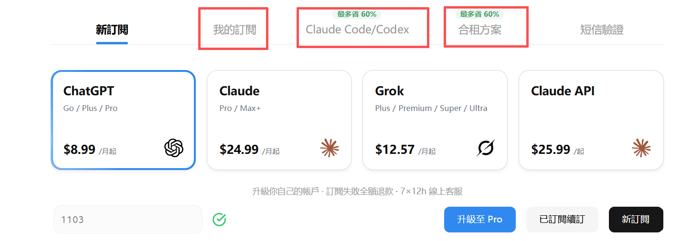
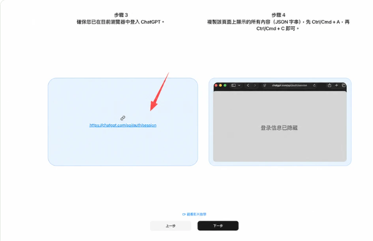

# WildAI 是什么？ChatGPT、Claude、Grok 订阅与使用指南

21世纪的生活仿佛被ai占据了，用ChatGPT 能帮你改文案，那Claude 能帮你查代码，写程序，还有很多日常事情都离不开ai。

很多人想搭上ai的列车，却发现无法付款。不支持微信支付宝，国内银行卡也用不了。

WildAI（bewild.ai）瞄准的，就是这道门槛。

它提供 ChatGPT、Claude 等海外 AI 服务的订阅和续订入口，让想用这些工具的人，多一种办理方式。

从服务内容来看，WildAI 把几种热门 AI 工具的订阅集中到了一个页面。ChatGPT、Claude、Grok 都有对应选项。

你可以按需求选择产品，再查看具体套餐，办理新订阅或续订。传送门：[https://bewild.ai/?code=1103](https://bewild.ai/?code=1103)

比如，就拿我自己的经验来说，我之前已经用惯了 ChatGPT，薅完了免费的羊毛，想看看付费版本会不会更好用一些，就可以用wildai去查看自己账号的升级方案；如果你是主要用 Claude，也能在同一个平台找到对应入口。

对已经确定要订阅的人来说，这样的平台方便在几个地方：可以让有购买需求的能集中查看产品和套餐，有新订阅、续订的对应流程，也能找到教程、费用说明和客服入口。

最终要付多少钱，买到什么权益，售后怎么处理，付款前看清楚，再判断这笔服务费用值不值得。

那么，哪些人会需要 WildAI？不妨想象三个场景。

一个学生正在赶课程报告的ddl，想订阅 ChatGPT Plus帮忙梳理资料，却迟迟卡在付款页面。

一个开发者已经用惯了 Claude，想用ai帮助自己提升效率，之前使用虚拟卡失败过，这次想换个办理渠道，少折腾一些。

还有一个做内容的自由职业者，想看看付费 AI 到底能帮上多少忙。只想先用一段时间感受感受，短期体验ai工具。

这几类人都可以了解一下 WildAI。有人缺支付渠道，有人想减少操作上的麻烦，也有人只想先用一段时间，再决定续不续。

WildAI 怎么用？可以按三步来。首先打开 WildAI 官方订阅页面，点击“登录”，按提示登录或注册平台账号。(记得填写邀请码1103，有一美金优惠)

第二步，选好你要订阅的产品，比如 ChatGPT 或 Claude，再确认套餐等级和订阅周期，是合租还是自己的账号进行升级。

第三步，跟着页面提示填写所需信息，核对账号和最终金额，使用结账页提供的支付方式完成付款。

如果流程涉及 Session 等登录凭证，记得千万要保存哦，别发到群聊或评论区。

付款后也记得看一眼订单状态；如果买的是自己的账号升级方案，再回到对应产品里，确认会员权益有没有到账。

如果真的遇到哪一步看不懂，就先查页面教程或联系客服，问清楚再继续。

好了，以上就是全部内容了！
